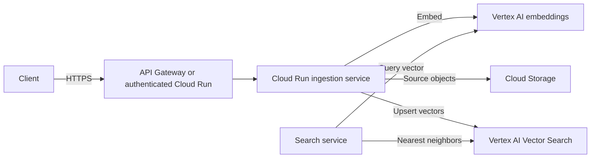

# Building Alex: Part 3 - Ingestion and Vector Search

This guide deploys the GCP ingestion stack using Cloud Run, Cloud Storage for source documents, Vertex AI for embeddings, and Vertex AI Vector Search for similarity retrieval. Vertex AI Vector Search has its own index and endpoint lifecycle and may have ongoing costs; check current pricing before deployment.

## Prerequisites

- Completed [Guide 1](1_permissions.md) and [Guide 2](2_embeddings.md)
- `gcloud`, Docker, and `uv`
- A GCP runtime service account with narrowly scoped access to Vertex AI and the required storage/vector resources
- A verified embedding model and dimension
- The GCP dependencies installed with `uv sync`

## Architecture



Cloud Storage is useful for retaining source documents and metadata; it is not itself a vector database. Vertex AI Vector Search is a managed vector service, not a drop-in replacement for the S3 Vectors API. A smaller learning deployment may instead evaluate PostgreSQL `pgvector` on Cloud SQL; compare scale, operational requirements, and costs before choosing.

## Step 1: Decide access and data boundaries

Choose whether ingestion is private (recommended for service-to-service use) or exposed through API Gateway. Use Clerk/JWT validation or another proper identity mechanism for user-facing APIs. An API key alone is not user authentication and should not be treated as protection for personal financial data.

Store only the data needed for retrieval. Keep user-specific data isolated in metadata and enforce authorization on every search; vector metadata filters are not a substitute for application-level access checks.

## Step 2: Create GCP infrastructure

Provision these GCP resources using the Google Cloud Console/CLI. The old AWS `terraform/3_ingestion` module is retired and must not be applied.

Create a private Cloud Storage bucket with uniform bucket-level access. Use a globally unique name and your chosen region:

```bash
gcloud storage buckets create gs://YOUR_UNIQUE_BUCKET --project YOUR_PROJECT_ID --location YOUR_REGION --uniform-bucket-level-access --public-access-prevention
```

In Google Cloud Console, open **Vertex AI → Vector Search → Indexes** and create a streaming index. Set its dimension to the verified Guide 2 embedding dimension, choose the distance measure and index settings for your workload, then create a matching index endpoint and deploy the index to it. A deployed Vector Search endpoint can incur ongoing costs. Record the index ID, endpoint ID, deployed index ID, and public endpoint domain shown by the console. Do not expose the endpoint without authentication.

Guide 3 provisions these model-dependent vector resources in the console and deploys the service with `gcloud`; the AWS Terraform module is retired. Do not put API keys or service account credentials in source control.

## Step 3: Port and deploy the ingestion code

The GCP implementation uses `gcp_ingestion.py` with the Vertex AI embedding client from Guide 2, Cloud Storage for source JSON, and Vertex AI Vector Search for embeddings. `gcp_service.py` exposes an HTTP API designed for authenticated Cloud Run service-to-service use.

Set the non-secret Cloud Run configuration:

```text
GOOGLE_CLOUD_PROJECT=YOUR_PROJECT_ID
GOOGLE_CLOUD_REGION=YOUR_REGION
GOOGLE_CLOUD_LOCATION=YOUR_VERTEX_EMBEDDING_LOCATION
EMBEDDING_MODEL=YOUR_SUPPORTED_VERTEX_EMBEDDING_MODEL
EMBEDDING_OUTPUT_DIMENSIONALITY=YOUR_VERIFIED_DIMENSION
DOCUMENT_BUCKET=YOUR_PRIVATE_GCS_BUCKET
VECTOR_INDEX_ID=YOUR_VERTEX_VECTOR_INDEX_ID
VECTOR_INDEX_ENDPOINT_ID=YOUR_VERTEX_VECTOR_INDEX_ENDPOINT_ID
VECTOR_DEPLOYED_INDEX_ID=YOUR_DEPLOYED_INDEX_ID
VECTOR_PUBLIC_ENDPOINT_DOMAIN=YOUR_PUBLIC_VECTOR_ENDPOINT_DOMAIN
```

The GCP API stores source documents at `tenant_id/document_id.json` and stores only the tenant filter and embedding in the vector index. Search always submits a `tenant_id` namespace filter and verifies the source object's tenant before returning it. Pass `tenant_id` only from a trusted caller that has already validated the user's Clerk identity; do not let an unauthenticated browser choose it. Keep the Cloud Run service private and grant `roles/run.invoker` only to the intended API or researcher service account. Cloud Run IAM authenticates the calling workload, not the end user, so the upstream service must enforce user authentication and derive the tenant ID from the verified Clerk token.

The endpoints are `POST /ingest` with `{"text":"...","tenant_id":"...","metadata":{}}`, `POST /search` with `{"query":"...","tenant_id":"...","limit":5}`, and `GET /healthz`. Requests and metadata are validated; errors do not return raw provider error details.

Port and deploy the service so it:

1. Validates and normalizes the request.
2. Calls Vertex AI to create an embedding.
3. Stores the source document in Cloud Storage where required.
4. Upserts vector ID, vector values, and safe metadata to the selected vector index.
5. Returns a stable document ID and explicit errors.

Build the GCP container with Cloud Build and deploy it to Cloud Run. Provision the bucket, Vector Search index and endpoint/deployed index, service identity, and IAM bindings as described in Step 2. AWS Lambda zip packaging is retired and is not used.

```bash
cd backend/ingest
uv sync
uv run test_vertex_embeddings.py
uv run test_gcp_ingestion.py
```

Create a Docker Artifact Registry repository if one does not already exist, then build and push the image:

```bash
# Run only if the repository does not already exist:
gcloud artifacts repositories create alex-ingestion --repository-format=docker --location YOUR_REGION --project YOUR_PROJECT_ID
gcloud auth configure-docker YOUR_REGION-docker.pkg.dev
docker build --platform linux/amd64 -f Dockerfile.gcp -t YOUR_REGION-docker.pkg.dev/YOUR_PROJECT_ID/alex-ingestion/ingestion:dev .
docker push YOUR_REGION-docker.pkg.dev/YOUR_PROJECT_ID/alex-ingestion/ingestion:dev
```

Create a dedicated runtime service account and grant it access to the bucket and Vertex AI. Deploy the image as a private Cloud Run service with the settings above. Configure Google API access through ADC; do not create service account keys. Grant `roles/run.invoker` only to the API and Researcher identities that need ingestion/search. Public Vector Search endpoints still require authenticated requests from the service; restrict egress and endpoint access according to the chosen network design.

```bash
gcloud iam service-accounts create alex-ingestion --project YOUR_PROJECT_ID --display-name "Alex ingestion runtime"
gcloud storage buckets add-iam-policy-binding gs://YOUR_UNIQUE_BUCKET --member="serviceAccount:alex-ingestion@YOUR_PROJECT_ID.iam.gserviceaccount.com" --role="roles/storage.objectUser"
gcloud projects add-iam-policy-binding YOUR_PROJECT_ID --member="serviceAccount:alex-ingestion@YOUR_PROJECT_ID.iam.gserviceaccount.com" --role="roles/aiplatform.user"
gcloud run deploy alex-ingestion --image YOUR_REGION-docker.pkg.dev/YOUR_PROJECT_ID/alex-ingestion/ingestion:dev --region YOUR_REGION --project YOUR_PROJECT_ID --service-account alex-ingestion@YOUR_PROJECT_ID.iam.gserviceaccount.com --no-allow-unauthenticated --set-env-vars GOOGLE_CLOUD_PROJECT=YOUR_PROJECT_ID,GOOGLE_CLOUD_REGION=YOUR_REGION,GOOGLE_CLOUD_LOCATION=YOUR_VERTEX_EMBEDDING_LOCATION,EMBEDDING_MODEL=YOUR_SUPPORTED_VERTEX_EMBEDDING_MODEL,EMBEDDING_OUTPUT_DIMENSIONALITY=YOUR_VERIFIED_DIMENSION,DOCUMENT_BUCKET=YOUR_UNIQUE_BUCKET,VECTOR_INDEX_ID=YOUR_VECTOR_INDEX_ID,VECTOR_INDEX_ENDPOINT_ID=YOUR_VECTOR_INDEX_ENDPOINT_ID,VECTOR_DEPLOYED_INDEX_ID=YOUR_DEPLOYED_INDEX_ID,VECTOR_PUBLIC_ENDPOINT_DOMAIN=YOUR_PUBLIC_ENDPOINT_DOMAIN
```

## Step 4: Configure and test

Use the Cloud Run service identity for Google Cloud API authentication. These integration settings are resource identifiers, not secrets. If future processing adds API credentials, store them in Secret Manager and grant access only to the service identity.

Test in stages:

1. Invoke `/healthz` and confirm the service starts.
2. Submit a document through `/ingest`; confirm the source object exists under its tenant prefix and the vector was upserted.
3. Query through `/search` with the same tenant and embedding model and confirm relevant results.
4. Search using a different tenant ID and confirm no original tenant document is returned.
5. Confirm unauthenticated requests cannot invoke the private Cloud Run service and that the upstream identity layer never trusts a browser-supplied tenant ID.

Do not expose raw embeddings, personal metadata, or service credentials in logs.

## Troubleshooting

- **Permission denied:** identify the Cloud Run service account and grant only the missing resource permission.
- **Dimension mismatch:** compare the model's actual output dimension to the index configuration.
- **No search results:** verify index deployment state, vector IDs, namespace/filter rules, and that ingestion and search use the same model.
- **Unexpected costs:** inspect Vertex AI Vector Search index/endpoint provisioning and Cloud Run usage; delete unused billable resources.

## Cleanup

Delete or undeploy the vector index endpoint and other billable resources when finished, taking care not to delete production data. Cloud Storage objects may persist after service deletion; apply retention and deletion policies intentionally.

## Next

Continue to [4_researcher.md](4_researcher.md) to deploy the market research agent on Cloud Run.
