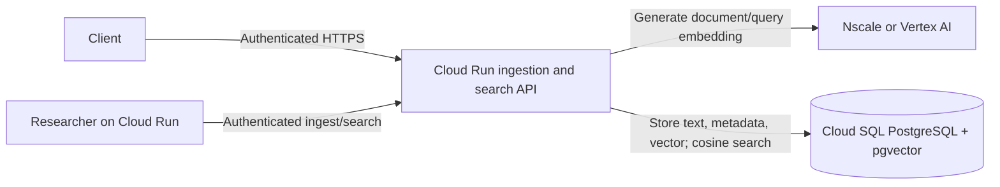

# Building Alex: Part 3 - Ingestion and Semantic Search with pgvector

This guide deploys the ingestion API on Cloud Run. It creates embeddings with the provider selected in Guide 2 and stores both source text and vectors in Cloud SQL for PostgreSQL using `pgvector`. No Cloud Storage bucket or Vertex AI Vector Search endpoint is required for this flow.

`pgvector` is a PostgreSQL extension, not a separate Google Cloud service. Cloud SQL still has its normal instance, storage, backup, and network costs; there is no separate deployed vector-search endpoint to provision.

## Prerequisites

- Completed Guides 1, 2, and 5, in that order
- A running Cloud SQL PostgreSQL instance and the `alex` database
- The `vector` extension installed in the database and migration `002_pgvector.sql` applied
- A GCP runtime service account included in Guide 5's `runtime_service_accounts`
- `gcloud`, Docker, and `uv`
- An embedding model and its actual output dimension verified with Guide 2

## Architecture



Cloud SQL stores the relational application data and the research documents/embeddings. Search uses PostgreSQL cosine distance (`<=>`) and filters by tenant in SQL. The initial implementation uses exact nearest-neighbor ranking, which avoids a separate vector service and is appropriate for a small learning corpus. If the corpus grows, benchmark query latency and evaluate a pgvector ANN index, dimensions, and Cloud SQL sizing.

## Step 1: Install pgvector and create its table

Cloud SQL permits extension creation only to a user with the `cloudsqlsuperuser` role. In Cloud SQL Studio, connect to the `alex` database as the `postgres` user and run:

```sql
CREATE EXTENSION IF NOT EXISTS vector;
```

Then connect with the configured migration/database user and apply migrations from `backend/database`:

```bash
uv sync --extra gcp
uv run run_migrations.py
```

Migration `002_pgvector.sql` creates `research_documents` and a B-tree index on `tenant_id`. The app database user defaults to `alex_app`; if you changed `database_user` in Guide 5, update the migration's `GRANT` target accordingly before applying it. Verify the table and extension in Cloud SQL Studio:

```sql
SELECT extname, extversion FROM pg_extension WHERE extname = 'vector';
SELECT column_name, udt_name FROM information_schema.columns
WHERE table_name = 'research_documents';
```

## Step 2: Configure ingestion

Use the same embedding provider, model, and output dimension for both document ingestion and query search. For Nscale, configure the non-secret settings:

```dotenv
EMBEDDING_PROVIDER=nscale
EMBEDDING_MODEL=Qwen/Qwen3-Embedding-8B
EMBEDDING_OUTPUT_DIMENSIONALITY=YOUR_VERIFIED_DIMENSION
NSCALE_BASE_URL=https://inference.api.nscale.com/v1
DATABASE_BACKEND=cloud_sql
CLOUD_SQL_CONNECTION_NAME=PROJECT_ID:REGION:INSTANCE_NAME
CLOUD_SQL_IP_TYPE=PUBLIC
DB_NAME=alex
DB_USER=alex_app
```

Also provide `NSCALE_API_KEY` and `DB_PASSWORD` locally through the ignored `.env` file. Never commit credentials. In Cloud Run, inject both secrets from Secret Manager. The Cloud SQL connection name is available from the Cloud SQL instance details or Guide 5 Terraform outputs.

For Vertex AI embeddings instead, set `EMBEDDING_PROVIDER=vertex_ai`, configure the supported embedding model and `GOOGLE_CLOUD_PROJECT` / `GOOGLE_CLOUD_LOCATION`, and grant model invocation access to the runtime identity. The Cloud SQL settings remain the same.

## Step 3: Run local tests

From `backend/ingest`, run the offline tests. They use mocked embeddings and a fake database client and do not require GCP or Nscale credentials:

```bash
uv sync
uv run test_vertex_embeddings.py
uv run test_nscale_embeddings.py
uv run test_embedding_client.py
uv run test_gcp_ingestion.py
```

To check actual Nscale model access and output dimension, make one live request:

```bash
uv run --env-file .env test_nscale_embeddings_live.py
```

This calls Nscale and may consume Nscale credits. For a live database check, the Cloud SQL instance must be running; authenticate locally with ADC and run the database connectivity check from Guide 5. End-to-end ingest/search needs both a valid Nscale token and Cloud SQL access.

## Step 4: Build and deploy the API

Include `alex-ingestion@YOUR_PROJECT_ID.iam.gserviceaccount.com` in the Cloud SQL stack's `runtime_service_accounts` so Terraform grants it `roles/cloudsql.client` and access to the database-password secret. If you already applied that stack without this account, add it to `terraform.tfvars`, then run and review `terraform plan` before applying. Alternatively, grant the permissions manually as shown below. Create the service account if needed:

```bash
gcloud iam service-accounts create alex-ingestion \
  --project YOUR_PROJECT_ID \
  --display-name "Alex ingestion runtime"
```

For manual IAM setup (or to repair a deployment after changing its runtime service account), grant Cloud SQL Client and secret access to the ingestion identity. These grants are resource-scoped where possible; run the secret command for the provider configured in Step 2. Skip grants already managed by the Guide 5 Terraform stack.

```bash
gcloud projects add-iam-policy-binding YOUR_PROJECT_ID \
  --member="serviceAccount:alex-ingestion@YOUR_PROJECT_ID.iam.gserviceaccount.com" \
  --role="roles/cloudsql.client"

gcloud secrets add-iam-policy-binding alex-cloud-sql-password \
  --project YOUR_PROJECT_ID \
  --member="serviceAccount:alex-ingestion@YOUR_PROJECT_ID.iam.gserviceaccount.com" \
  --role="roles/secretmanager.secretAccessor"

# For Nscale embeddings:
gcloud secrets add-iam-policy-binding alex-nscale-token \
  --project YOUR_PROJECT_ID \
  --member="serviceAccount:alex-ingestion@YOUR_PROJECT_ID.iam.gserviceaccount.com" \
  --role="roles/secretmanager.secretAccessor"
```

For Vertex AI embeddings, the ingestion service does not need the Nscale secret; grant any required Vertex AI model permissions to the runtime identity as described in Guide 2.

Create the Artifact Registry repository before pushing the image. This is separate from the `alex-agents` repository created by the Guide 6 Terraform stack. Run the create command only once; if the repository already exists in this project and region, skip it.

```bash
gcloud services enable artifactregistry.googleapis.com --project YOUR_PROJECT_ID
gcloud artifacts repositories create alex-ingestion \
  --repository-format=docker \
  --location=YOUR_REGION \
  --description="Alex ingestion API images" \
  --project YOUR_PROJECT_ID
gcloud auth configure-docker YOUR_REGION-docker.pkg.dev
```

Build from the `backend` directory because the image installs the shared `alex-database` package:

```bash
cd backend
docker build --platform linux/amd64 -f ingest/Dockerfile.gcp \
  -t YOUR_REGION-docker.pkg.dev/YOUR_PROJECT_ID/alex-ingestion/ingestion:dev .
docker push YOUR_REGION-docker.pkg.dev/YOUR_PROJECT_ID/alex-ingestion/ingestion:dev
```

Deploy the service privately and attach its Cloud SQL instance. Create `alex-nscale-token` in Secret Manager first if it does not exist, and grant the runtime service account access to that secret:

```bash
gcloud run deploy alex-ingestion \
  --image YOUR_REGION-docker.pkg.dev/YOUR_PROJECT_ID/alex-ingestion/ingestion:dev \
  --region YOUR_REGION \
  --project YOUR_PROJECT_ID \
  --service-account alex-ingestion@YOUR_PROJECT_ID.iam.gserviceaccount.com \
  --add-cloudsql-instances YOUR_PROJECT_ID:YOUR_REGION:YOUR_INSTANCE_NAME \
  --no-allow-unauthenticated \
  --set-env-vars EMBEDDING_PROVIDER=nscale,EMBEDDING_MODEL=Qwen/Qwen3-Embedding-8B,EMBEDDING_OUTPUT_DIMENSIONALITY=YOUR_VERIFIED_DIMENSION,NSCALE_BASE_URL=https://inference.api.nscale.com/v1,DATABASE_BACKEND=cloud_sql,CLOUD_SQL_CONNECTION_NAME=YOUR_PROJECT_ID:YOUR_REGION:YOUR_INSTANCE_NAME,CLOUD_SQL_IP_TYPE=PUBLIC,DB_NAME=alex,DB_USER=alex_app \
  --set-secrets NSCALE_API_KEY=alex-nscale-token:latest,DB_PASSWORD=alex-cloud-sql-password:latest
```

The Cloud Run service URL is a Google-hosted HTTPS endpoint and is normally reachable over the internet. `--no-allow-unauthenticated` prevents unauthenticated invocation; it does not make the URL network-private or restrict access to callers in your GCP project. Grant `roles/run.invoker` only to the API and Researcher identities that need it, and have callers send a Google-signed ID token. If network-level restriction is required, configure Cloud Run ingress and the necessary VPC or load-balancer path separately; IAM authentication and network ingress are distinct controls. The upstream API must still authenticate the user and derive the tenant ID from the verified Clerk identity.

## Step 5: Verify ingestion and tenant-scoped search

1. Invoke `GET /healthz`.
2. Send a short document to `POST /ingest`; verify its row and vector exist in `research_documents`.
3. Send a related query to `POST /search` with the same tenant and confirm relevant results.
4. Search as another tenant and confirm the first tenant's documents are not returned.
5. Confirm unauthenticated callers cannot invoke Cloud Run and no secrets, raw vectors, or sensitive financial content are logged.

The endpoints are `POST /ingest` with `{"text":"...","tenant_id":"...","metadata":{}}`, `POST /search` with `{"query":"...","tenant_id":"...","limit":5}`, and `GET /healthz`.

## Troubleshooting and costs

- **`vector` type or extension missing:** install `vector` in the `alex` database as the Cloud SQL `postgres` user, then rerun the migration.
- **Permission denied:** confirm the runtime identity has `roles/cloudsql.client`, the DB user/secret are correct, and the migration granted table access to that user.
- **Dimension mismatch:** ensure Nscale/Vertex returns the same dimension configured in `EMBEDDING_OUTPUT_DIMENSIONALITY` for both ingestion and query.
- **Slow search:** the current query computes exact cosine distance over that tenant's rows. Check Cloud SQL query performance and corpus size before selecting an ANN index or larger instance.
- **Unexpected costs:** review Cloud SQL instance, storage, backup, and network charges separately from Nscale inference credits or Vertex AI embedding charges.

## Next

Continue to [4_researcher.md](4_researcher.md) to deploy the market research agent on Cloud Run.
