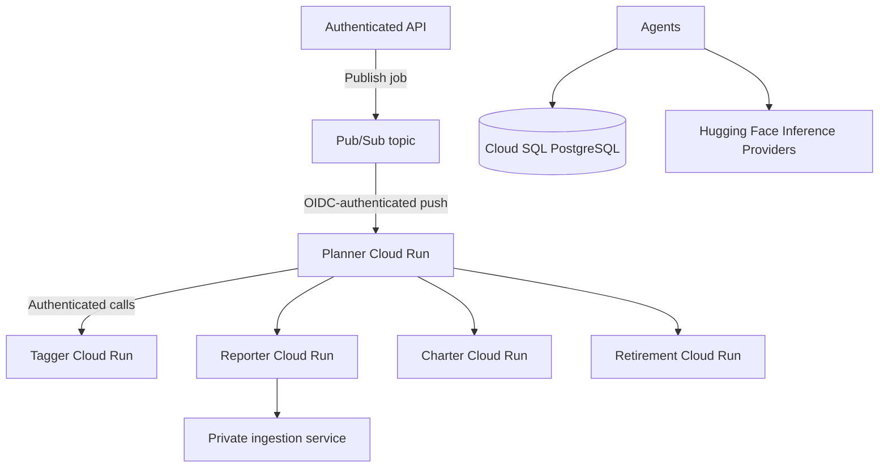

# Building Alex: Part 6 - Agent Orchestra on Google Cloud

Deploy the Planner, Tagger, Reporter, Charter, and Retirement agents as IAM-protected Cloud Run services, with Pub/Sub push delivery to Planner. This is the supported deployment; AWS Lambda/SQS is retired.

## Architecture



Pub/Sub delivery is at-least-once. The Planner atomically claims pending or failed jobs in Cloud SQL; deliveries for a running job are retried without starting duplicate work, while a completed job is acknowledged. A failed job can be claimed again, and a job left running by a hard timeout can be reclaimed after its 65-minute lease expires. Repeated failures are routed to a dead-letter topic.

## Prerequisites

- Completed Guides 1-5. The Cloud SQL instance, database schema, and private ingestion service must be ready.
- `gcloud`, Docker, Terraform 1.5+, and `uv` installed; Docker Desktop running for image builds.
- The `alex-api` and `alex-agents` service accounts created in Guide 5. The `alex-agents` identity must be listed in the Guide 5 stack's `runtime_service_accounts`, so it has Cloud SQL Client and database-password Secret Accessor roles.
- A provider/model combination that supports the tools and structured outputs used by the Agents SDK, plus its API token stored in Secret Manager. Hugging Face is the default; Nscale is also supported through its OpenAI-compatible endpoint.
- A Massive API key stored in Secret Manager if Planner price updates are desired. Price lookup is optional and does not block analysis.

The five agents and Researcher share the LLM factory in `backend/gcp_agents/gcp_agents/huggingface_model.py`. The adjacent `llm_config.json` is the configuration source for provider endpoints, key environment-variable names, and default model IDs; this Terraform stack reads that same JSON file. The default is Hugging Face Inference Providers at `https://router.huggingface.co/v1`, with `openai/gpt-oss-120b`. To use Nscale, set `llm_provider = "nscale"`, provide `llm_model` for a model in the Nscale catalog, and set `nscale_token_secret_id` to a Secret Manager secret containing the Nscale service token. Confirm the selected model supports the needed tool calling and structured output. Inference is hosted externally, not on GCP; embeddings and vector search continue to use Vertex AI.

For these five Terraform-managed services, put the provider selection in `terraform_gcp/6_agents/terraform.tfvars` (HCL, not `.env`):

```hcl
llm_provider          = "nscale"
llm_model             = "YOUR_NSCALE_MODEL_ID"
nscale_token_secret_id = "alex-nscale-token"
```

The Terraform variables override the shared JSON defaults; you do not need to edit `llm_config.json` to select Nscale here. The JSON supplies the default provider/model when Terraform values are omitted. For the separately deployed Researcher, set `ALEX_LLM_PROVIDER=nscale` and `ALEX_LLM_MODEL=YOUR_NSCALE_MODEL_ID` in its Cloud Run environment instead.

Before applying the stack, create the Hugging Face token secret in Secret Manager (if not already present) and add a version without placing the token in shell history:

```bash
# Skip the create command if this secret already exists.
gcloud secrets create alex-huggingface-token --replication-policy=automatic \
  --project YOUR_PROJECT_ID
read -s HF_TOKEN
printf '%s' "$HF_TOKEN" | gcloud secrets versions add alex-huggingface-token \
  --data-file=- --project YOUR_PROJECT_ID
unset HF_TOKEN
```

For Nscale, create the secret named by `nscale_token_secret_id` (default `alex-nscale-token`) and add the service token:

```bash
gcloud secrets create alex-nscale-token --replication-policy=automatic \
  --project YOUR_PROJECT_ID
read -s NSCALE_API_KEY
printf '%s' "$NSCALE_API_KEY" | gcloud secrets versions add alex-nscale-token \
  --data-file=- --project YOUR_PROJECT_ID
unset NSCALE_API_KEY
```

## Step 1: Run focused local tests

These tests use mocks and do not require GCP credentials or a live database:

```bash
cd backend/planner
uv run --extra gcp test_gcp_invocation.py
uv run --extra gcp -- python -m unittest discover -s ../gcp_agents -p "test_*.py"

cd ../database
uv run test_job_claim.py
```

The original `test_simple.py` scripts initialize the AWS database path and are not GCP smoke tests. Do not point them at production data. Existing `test_full.py` scripts invoke AWS resources and are not part of this GCP deployment.

## Step 2: Configure the Terraform stack

The GCP agent stack is in `terraform_gcp/6_agents`. The old AWS stack in `terraform/6_agents` is retired:

```bash
cd terraform_gcp/6_agents
cp terraform.tfvars.example terraform.tfvars
```

Edit `terraform.tfvars` with:

- Your project and region.
- The existing `alex-agents` and `alex-api` service account emails.
- The Cloud SQL connection name and database secret ID from `terraform_gcp/5_database` outputs.
- The private ingestion Cloud Run service name, region, URL, and audience from Guide 3. The audience is usually the service URL.
- The five Artifact Registry image URLs. Keep the image URLs under the repository created by this stack.
- Optionally, `llm_provider`, `llm_model`, and the selected provider's Secret Manager secret ID. Defaults come from the shared `llm_config.json`.
- Optionally, the Secret Manager ID holding the Massive API key.

Never put database passwords or API key values in this file. It is gitignored; Terraform state and local state backups still contain sensitive resource data and must be protected.

Initialize Terraform and create the Artifact Registry repository first:

```bash
terraform init
terraform validate
terraform apply -target=google_artifact_registry_repository.agents
```

Review the plan; it should create the Artifact Registry repository and enable the required APIs. The Cloud Run services and Pub/Sub resources are deployed after the images have been pushed.

## Step 3: Build and push the five agent images

Authenticate Docker to Artifact Registry, then run the following commands from the `backend` directory. Replace `REGION` and `PROJECT_ID` with the values used in `terraform.tfvars`. Each image uses the shared GCP Cloud Run wrapper and a role-specific handler.

```bash
# From the project root:
cd backend
gcloud auth configure-docker REGION-docker.pkg.dev

docker build --platform linux/amd64 -f gcp_agents/Dockerfile.gcp-agent --build-arg AGENT_DIR=planner -t REGION-docker.pkg.dev/PROJECT_ID/alex-agents/planner:dev .
docker push REGION-docker.pkg.dev/PROJECT_ID/alex-agents/planner:dev
docker build --platform linux/amd64 -f gcp_agents/Dockerfile.gcp-agent --build-arg AGENT_DIR=tagger -t REGION-docker.pkg.dev/PROJECT_ID/alex-agents/tagger:dev .
docker push REGION-docker.pkg.dev/PROJECT_ID/alex-agents/tagger:dev
docker build --platform linux/amd64 -f gcp_agents/Dockerfile.gcp-agent --build-arg AGENT_DIR=reporter -t REGION-docker.pkg.dev/PROJECT_ID/alex-agents/reporter:dev .
docker push REGION-docker.pkg.dev/PROJECT_ID/alex-agents/reporter:dev
docker build --platform linux/amd64 -f gcp_agents/Dockerfile.gcp-agent --build-arg AGENT_DIR=charter -t REGION-docker.pkg.dev/PROJECT_ID/alex-agents/charter:dev .
docker push REGION-docker.pkg.dev/PROJECT_ID/alex-agents/charter:dev
docker build --platform linux/amd64 -f gcp_agents/Dockerfile.gcp-agent --build-arg AGENT_DIR=retirement -t REGION-docker.pkg.dev/PROJECT_ID/alex-agents/retirement:dev .
docker push REGION-docker.pkg.dev/PROJECT_ID/alex-agents/retirement:dev
```

These Docker commands work in PowerShell as written when each command is on one line. For production, use immutable image tags rather than reusing `dev`.

Return to `terraform_gcp/6_agents` and make sure `agent_image_urls` in `terraform.tfvars` exactly matches the pushed image names.

## Step 4: Deploy services and Pub/Sub

Review and apply the full plan:

```bash
terraform plan
terraform apply
```

The stack creates five Cloud Run services, a Pub/Sub jobs topic, an authenticated push subscription to Planner, a dead-letter topic/subscription, and a dedicated push identity. It injects the selected provider token from Secret Manager and grants:

- The agent runtime identity Secret Manager access to the selected provider token, and grants it `roles/run.invoker` on the agent and ingestion services.
- The API identity `roles/pubsub.publisher` on only the jobs topic.
- The Pub/Sub push identity `roles/run.invoker` on Planner.
- The Pub/Sub service agent permission to mint push identity tokens and publish to the dead-letter topic.

Cloud Run allows network ingress but does not grant `allUsers` invocation. Calls require a Google-signed ID token and IAM invoker permission. Do not make these services public. Keep the existing Guide 5 grants for Cloud SQL and the database password secret.

The Planner runs the full workflow before acknowledging the Pub/Sub push. Its Cloud Run request timeout is longer than the Pub/Sub acknowledgment window; duplicate deliveries for an in-progress job receive a retryable response, and the job lease permits recovery after a hard timeout. Limit service instances and concurrency to protect Cloud SQL connection capacity and model quotas.

## Step 5: Verify configuration and observe

Get the created service and queue names:

```bash
terraform output agent_service_urls
terraform output jobs_topic
terraform output jobs_subscription
terraform output dead_letter_subscription
```

Use Cloud Run logs and Pub/Sub metrics to verify service startup, message delivery, retries, and dead-letter routing. A full analysis trigger from the application is completed with the GCP API integration in Guide 7.

Once the GCP API is deployed, submit a development analysis and verify:

1. The job is created as pending and published to the jobs topic.
2. Planner claims it once, calls the required agents, and persists the result in Cloud SQL.
3. The job reaches completed; repeated deliveries do not rerun completed or running work.
4. A deliberately failing development message retries and appears in the dead-letter subscription after the configured number of attempts.
5. Reporter searches the private ingestion service using the tenant from the persisted job, not a caller-supplied tenant.

## Troubleshooting

- **Cloud Run fails to start:** check the service role, image URL, startup probe, Cloud Run logs, and `ALEX_AGENT_ROLE`.
- **LLM provider authentication, model, or rate-limit errors:** verify `llm_provider`, its matching Secret Manager secret and access binding, model/provider availability, and current quota.
- **Database or secret access denied:** verify that the same `alex-agents` service account is listed in Guide 5's `runtime_service_accounts`; confirm the secret ID and Cloud SQL connection name.
- **Planner cannot call another agent:** verify the service URL variables and `roles/run.invoker` binding for `alex-agents`.
- **Reporter gets 403 from ingestion:** verify `ALEX_INGESTION_URL`, audience, and the ingestion service's invoker binding for `alex-agents`.
- **Pub/Sub delivery fails:** verify Planner's invoker binding for `alex-pubsub-push`, the subscription's OIDC audience, and the Pub/Sub service agent bindings.
- **Database connection exhaustion:** reduce Cloud Run maximum instances/concurrency and account for the Cloud SQL connector connection per instance.
- **Messages repeat:** inspect job status and logs. Running jobs are retried but not run concurrently; pending, failed, and expired-running jobs can be claimed.

## Cost and cleanup

Cloud SQL, Vertex AI Vector Search, and the selected inference provider can incur costs independently of Cloud Run. Review GCP and provider usage; quotas and prices can change. Shut down resources when not actively learning. To remove this layer, first disable or destroy the subscription and agent stack:

```bash
cd terraform_gcp/6_agents
gcloud artifacts docker images delete REGION-docker.pkg.dev/PROJECT_ID/alex-agents/planner --delete-tags --quiet
gcloud artifacts docker images delete REGION-docker.pkg.dev/PROJECT_ID/alex-agents/tagger --delete-tags --quiet
gcloud artifacts docker images delete REGION-docker.pkg.dev/PROJECT_ID/alex-agents/reporter --delete-tags --quiet
gcloud artifacts docker images delete REGION-docker.pkg.dev/PROJECT_ID/alex-agents/charter --delete-tags --quiet
gcloud artifacts docker images delete REGION-docker.pkg.dev/PROJECT_ID/alex-agents/retirement --delete-tags --quiet
terraform destroy
```

This removes the Pub/Sub topics, Cloud Run services, service identity, and Artifact Registry repository, but does not destroy the Cloud SQL database or ingestion resources from earlier guides. Verify backups and data retention before deleting earlier layers.

## Next

Continue to [7_frontend.md](7_frontend.md) to deploy the API that creates jobs and publishes them to Pub/Sub.
