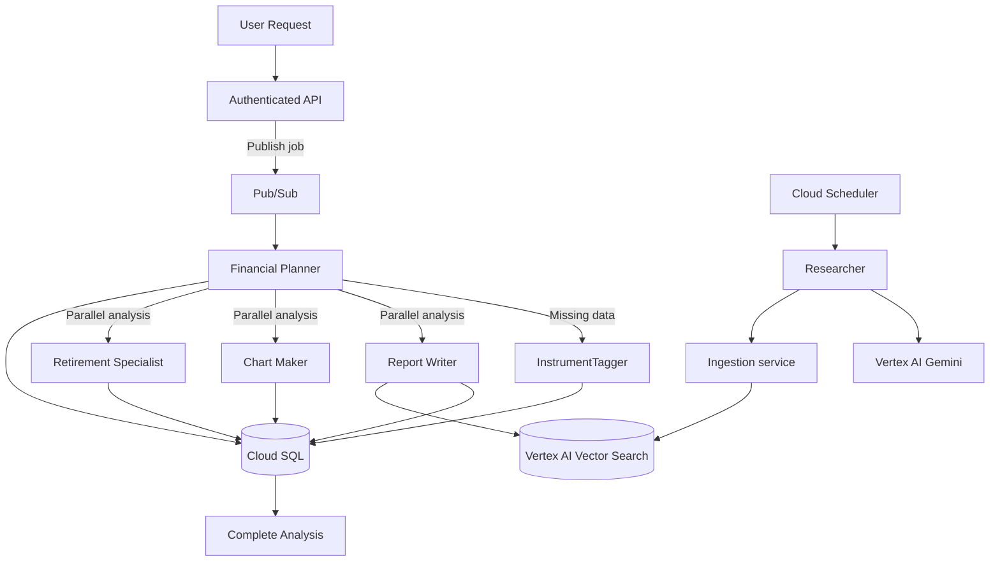

# Alex Agent Architecture - Google Cloud

The GCP version keeps Alex's agent responsibilities and collaboration patterns provider-neutral while changing the runtime and cloud integrations. See [architecture.md](architecture.md) for the service mapping.

## Agent collaboration

## Agent responsibilities

| Agent | Responsibility | Typical output |
|---|---|---|
| Financial Planner | Orchestrates a job, selects agents, compiles completion status | Job status and summary |
| InstrumentTagger | Classifies unknown financial instruments and allocation | Validated structured data |
| Report Writer | Produces a portfolio narrative using relevant retrieved research | Markdown report |
| Chart Maker | Produces visualization data for the frontend | Validated chart JSON |
| Retirement Specialist | Calculates projections and retirement scenarios | Projection and assumptions |
| Researcher | Gathers external market information and submits it to ingestion | Research document |

## Communication and reliability

The API stores a job record and publishes a job ID to Pub/Sub. An authenticated push subscription invokes Planner; retries and duplicate deliveries are possible. Use a stable job ID, idempotent database writes, explicit job-state transitions, a bounded retry policy, and a dead-letter topic. Planner can call internal Cloud Run agent services using service-to-service identity, or the implementation can run selected agents in-process; choose one model and document its failure boundaries.

Do not assume Pub/Sub ordering or exactly-once business processing. Persist each agent's result independently and mark a job complete only after required work has succeeded. Report partial failure explicitly rather than returning a success-shaped empty response.

The scheduled Researcher is independent of user-triggered Planner work. Cloud Scheduler invokes it using OIDC and a dedicated runtime identity. The Researcher must treat browser results as untrusted data, limit browsing scope, and avoid turning retrieved instructions into tool commands.

## Model and tool design

Select a Vertex AI model that supports the required tool/function-calling behavior and validate it in the chosen region. The AWS `bedrock/...` model identifiers, AWS credentials, and Bedrock region environment variables do not apply. Port the model adapter and test tool calls, structured output parsing, timeout, quota, and retry behavior.

Preserve the existing OpenAI Agents SDK constraint noted in the AWS project: an agent should use either structured outputs or tools when the selected model/provider integration cannot support both reliably. Verify current SDK/provider capabilities rather than assuming provider parity.

## Data and explainability

Store user data and agent results in Cloud SQL. Keep shared instrument reference data separate from tenant-owned accounts, holdings, and analysis jobs. Enforce ownership using the verified Clerk user ID on every access.

Expose concise user-facing rationale, cited/source data, assumptions, and limitations. Do not expose hidden chain-of-thought or raw internal traces. Validate chart and classification outputs before persistence and rendering.

## Planned extensions

- More explicit provenance and freshness metadata for market data
- Stronger job orchestration and cancellation behavior
- Additional specialists such as tax, rebalancing, or risk analysis
- Evaluation datasets and regression tests for model changes
