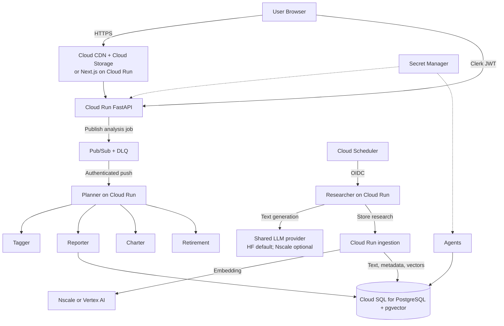

# Alex Architecture Overview - Google Cloud

This is the supported GCP architecture for Alex. AWS service names below are shown only to explain the historical service mapping; AWS deployment is retired.

## System architecture

## Service mapping

| AWS reference | Google Cloud target | Notes |
|---|---|---|
| IAM users/groups and roles | Cloud IAM users/groups and service accounts | Use workload identity where possible; avoid long-lived keys. |
| SageMaker embedding endpoint | Nscale or Vertex AI embedding API | Verify model dimensions and provider billing. Embedding generation is separate from vector storage/search. |
| S3 Vectors | Cloud SQL PostgreSQL with `pgvector` | Vectors, research text, metadata, and relational data share Cloud SQL. No separately provisioned vector endpoint. |
| S3 document bucket | Cloud SQL PostgreSQL | The current research-ingestion flow stores document text and metadata alongside vectors. |
| Lambda / API Gateway | Cloud Run services; API Gateway optional | Keep APIs authenticated and validate Clerk JWTs in application code. |
| App Runner | Cloud Run service | Containerized HTTP application. |
| ECR | Artifact Registry | Store pinned container images. |
| EventBridge Scheduler | Cloud Scheduler | Use OIDC-authenticated invocation. |
| Bedrock | OpenAI-compatible inference provider | Hugging Face is the default; Nscale is supported. Model names, token permissions, tool calling, quotas, and routing differ. |
| Aurora Serverless v2 + Data API | Cloud SQL for PostgreSQL | Requires connector/networking; no equivalent Data API and normally ongoing instance costs. |
| SQS | Pub/Sub | At-least-once delivery; use idempotency and a dead-letter topic. |
| CloudFront + S3 website | Cloud CDN + Cloud Storage or Cloud Run | Cloud Storage hosting is suitable only for a compatible static export. |
| CloudWatch / X-Ray | Cloud Logging / Cloud Monitoring / Cloud Trace | Confirm tracing instrumentation and sensitive-data handling. |
| WAF / GuardDuty | Cloud Armor / Security Command Center and related controls | Different feature sets, configuration, availability, and pricing. |

## Data and trust boundaries

- Clerk remains the user identity provider. The API validates each token and scopes database reads/writes to the verified Clerk user ID.
- Cloud IAM service accounts authenticate workloads to GCP APIs; they do not replace user authentication.
- Keep personal financial data in Cloud SQL with appropriate encryption, backups, access controls, and retention.
- Restrict vector search by tenant and enforce authorization in application logic.
- Treat external web pages and retrieved documents as untrusted input to agents.
- Keep secrets in Secret Manager and avoid logging prompts or financial records unnecessarily.

## Deployment model

Follow the GCP deployment guides in this order:

1. Project, IAM, APIs, and billing alerts
2. Nscale or Vertex AI embedding model selection and validation
3. Cloud SQL database, pgvector extension, and migrations
4. Ingestion and semantic search on Cloud Run
5. Researcher Cloud Run service and optional Cloud Scheduler job
6. Agent Cloud Run services, Pub/Sub, and dead-letter handling
7. API and frontend hosting
8. Monitoring, security controls, and guardrails

Keep Terraform state isolated per stage and protect it. Verify `terraform plan` and IAM grants before applying. Destroy development resources when not in use, keeping data retention and backups in mind.

## Cost considerations

The most material differences are likely Cloud SQL's running-instance charge, model token/embedding usage, Cloud Run minimum instances, network egress, and Cloud Logging retention. `pgvector` runs inside Cloud SQL and has no separate managed endpoint charge. Pricing and free tiers change; check current regional pricing and set billing alerts rather than copying AWS estimates.
